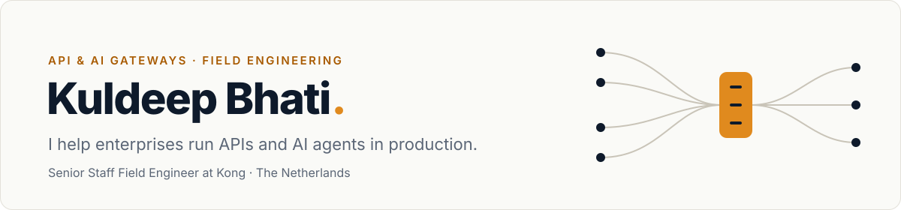

<picture>
  <source media="(prefers-color-scheme: dark)" srcset="assets/banner-dark.svg">
  
</picture>

  
  
  

I work with enterprise platform teams on the part of the stack every API and AI agent goes through: **the gateway**. Before Kong I built API platforms on Apigee, MuleSoft and 3scale. What carries over between products is less about the product and more about **integration patterns**: how you secure, govern, observe and migrate traffic at scale.

These days that means three things:

- **AI gateways and agent traffic.** Token budgets, model fallback, MCP and per-tool authorization, so LLM traffic gets the same controls as any other API.
- **Governance as code.** Linting gateway config in CI, declarative everything, checks that run before production instead of after.
- **Platform migrations.** Moving self-managed gateways to cloud control planes without breaking what already works.

### Upstream

Fixes and docs I've sent back when a tool I depend on was missing a piece:

| Project | Contribution |
|---|---|
| **[Kong/kong-operator](https://github.com/Kong/kong-operator/pull/5982)** | Fixed client-certificate renewal for `KonnectExtension`: register the new certificate with Konnect before data planes use it, so renewals stop causing 401s on the clustering endpoints |
| **[Kong/developer.konghq.com](https://github.com/Kong/developer.konghq.com/pull/7615)** | Document that `kongctl lint` uses vacuum rulesets, with a working example |
| **[Kong/kwot](https://github.com/Kong/kwot/pull/32)** | Inject RBAC user tokens from environment variables (CI secrets, no YAML pre-processing) and self-documenting role comments |

### Projects

| Repository | What it does |
|---|---|
| **[kong-grafana-observability-stack](https://github.com/bhatikuldeep/kong-grafana-observability-stack)** | Metrics, logs and traces for a Konnect hybrid gateway in Prometheus, Loki, Tempo and Grafana. Pinned versions, one command on a local kind cluster |
| **[kong-konnect-observability-datadog](https://github.com/bhatikuldeep/kong-konnect-observability-datadog)** | The same idea wired into Datadog, as Terraform |
| **[dvm](https://github.com/bhatikuldeep/dvm)** | decK Version Manager: install and switch between decK versions locally when you test configs across Kong releases |
| **[kong-hybrid-helm](https://github.com/bhatikuldeep/kong-hybrid-helm)** | A starting point for Kong hybrid mode on Kubernetes with Helm |

<b>From the Apigee years</b>

 

| Repository | What it does |
|---|---|
| **[hello-world-elk-logging](https://github.com/bhatikuldeep/hello-world-elk-logging)** | Message logging from Apigee Edge to the ELK stack |
| **[apigee-hybrid-x-provision](https://github.com/bhatikuldeep/apigee-hybrid-x-provision)** | Provisioning the Apigee hybrid control plane with Terraform |
| **[maven-archetype-apigee-proxy](https://github.com/bhatikuldeep/maven-archetype-apigee-proxy)** | Maven archetype that scaffolds an Apigee Edge API proxy |

### Writing

Long-form at **[kuldeepbhati.com](https://kuldeepbhati.com/posts/)**:

<!-- writing:start -->
- [Validating Kong route paths with a custom ruleset](https://kuldeepbhati.com/posts/kong-deck-lint-validation/)
- [Run local LLMs with Ollama and Open WebUI in Docker](https://kuldeepbhati.com/posts/run-local-llms-ollama-open-webui-docker/)
- [Kong Gateway hybrid mode setup with Helm](https://kuldeepbhati.com/posts/kong-hybrid-gateway-setup-via-helm/)
- [Managing multiple decK versions with DVM](https://kuldeepbhati.com/posts/deck-version-manager-dvm-guide/)
<!-- writing:end -->

### Toolbox

`Kong Gateway` · `Konnect` · `AI Gateway` · `decK` · `kongctl` · `Terraform` · `Kubernetes` · `Helm` · `Go` · `OpenTelemetry` · `Grafana` · `Datadog` · `Apigee` · `MuleSoft`

Based in the Netherlands. Views are my own.
